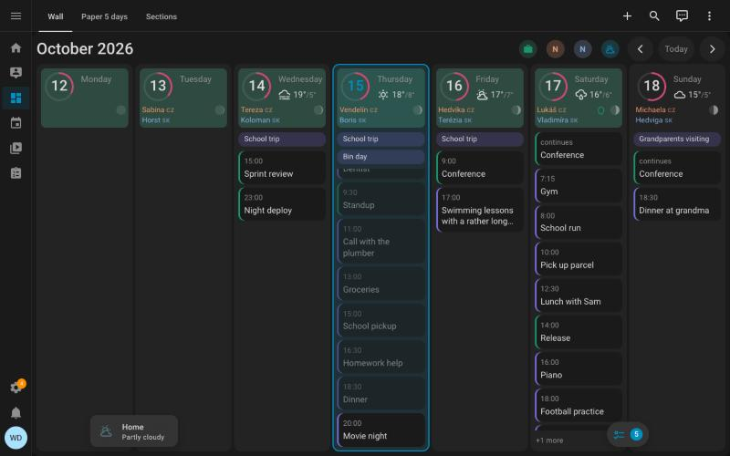

# WallCal

A week-at-a-glance calendar card for a Home Assistant wall tablet. Everyone's calendars side by
side, with the weather and the moon, readable from across the room.

**[See WallCal on the web →](https://tfoxik.github.io/wallcal/)**



## What it does

- **The whole week at once.** Seven (or five) day columns, today highlighted, and today's list
  scrolled to what's next.
- **All your calendars.** Any Home Assistant calendar, each in its own colour. Tap a chip in the
  top bar to hide one.
- **Name days and holidays as a line under the date**, so they don't crowd out real events.
- **Weather** for each day: icon plus high and low.
- **Moon phase** for each day.
- **Cycle tracking (optional):** expected period, fertile window and ovulation.
- **Floating cards:** keep a shopping list, or any other card, over the bottom of the week.
- **Your look:** three built-in themes, plus colours, fonts and sizes.
- **On your phone, too:** an agenda view for a Calendar tab, and a "next up" card for the Home view.
- **Made for old tablets:** runs on Android WebView 87+ and iOS 14.5+, with no animations.

## Install

### HACS (recommended)

[](https://my.home-assistant.io/redirect/hacs_repository/?owner=TFoxik&repository=wallcal&category=plugin)

1. Click the button, or in HACS open ⋮ → **Custom repositories** and add
   `https://github.com/TFoxik/wallcal` with type **Dashboard**.
2. Open **WallCal** in HACS and click **Download**.
3. Reload the browser (and the wall tablet).

### Manual

1. Download `wallcal-card.js` from the
   [latest release](https://github.com/TFoxik/wallcal/releases/latest) into `/config/www/`.
2. Under Settings → Dashboards → ⋮ → **Resources**, add `/local/wallcal-card.js?v=0.7.0` as a
   JavaScript module.
3. Reload the browser. After each update, raise the `?v=` number so tablets drop the cached copy.

## Add it to a dashboard

1. Edit a dashboard → **Add card** → search for **WallCal**.
2. Pick your calendars in the visual editor, or switch to the code editor and paste:

   ```yaml
   type: custom:wallcal-card
   entities:
     - calendar.family
     - entity: calendar.work
       color: "#7F77DD"
   ```

3. On a wall tablet, put the card in its own view with the **Panel** layout so it fills the screen.

The **[user guide](https://tfoxik.github.io/wallcal/docs/)** walks through everything WallCal can do, with examples and a map of
the card. **[All options](https://tfoxik.github.io/wallcal/docs/reference/options)** lists every option with its default.

## Good to know

- Cycle tracking settings live in the dashboard configuration: anyone who can open that dashboard
  can read them, and they are part of backups. The predictions are a calendar hint, not medical
  advice and not contraception.
- Hidden calendars and floating cards are remembered per device, so each tablet keeps its own
  choice.

## Contributing

Bug reports and ideas are welcome in [issues](https://github.com/TFoxik/wallcal/issues). See
[CONTRIBUTING.md](CONTRIBUTING.md) to build and test it locally.

## License

[MIT](LICENSE)
